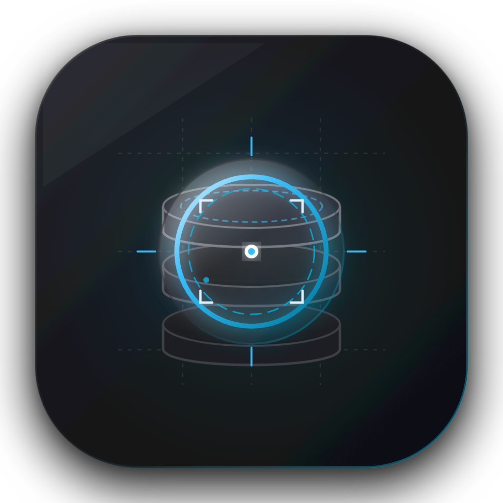

# DataPulse



A lightweight, native desktop client for all your databases. DataPulse is a cross-platform application for browsing, querying, and managing relational and key-value databases — connection profiles, a metadata tree, and a SQL editor in a small, fast, native-feeling app with no JVM or Electron runtime.

Built with a **Go backend ([Wails v3](https://v3.wails.io/))** and a **Svelte 5 + Vite + TypeScript** frontend.

## Features

- **Connection manager** — create, test, edit, duplicate, and delete profiles for PostgreSQL, MySQL/MariaDB, SQLite, Oracle, and Redis. Passwords are stored only in the OS keychain (GNOME Keyring / macOS Keychain / Windows Credential Manager), never in the JSON profile file.
- **Metadata explorer** — sidebar tree: connection → schemas/databases → tables/views → columns, foreign keys, and indexes. Lazy loading with per-node refresh, context actions (View Data, Generate SELECT, New SQL Query, and more).
- **SQL editor & executor** — CodeMirror 6 with SQL highlighting and schema-aware autocomplete, multi-tab workspace, run selection or statement-at-cursor (`Ctrl/Cmd+Enter`), query cancellation, server-side pagination, duration/row-count stats.
- **Safety guard** — `UPDATE`/`DELETE` without a `WHERE` clause is blocked and requires explicit confirmation; `DROP`/`TRUNCATE`/`ALTER` need a softer confirm.
- **Results grid** — paginated with sticky headers, client-side column sorting, NULL-aware formatting, and CSV/JSON export.
- **Local-first & private** — works fully offline, no telemetry.

## Supported Databases

| Engine             | Driver package                    | Notes                                   |
| ------------------ | --------------------------------- | --------------------------------------- |
| PostgreSQL         | `internal/driver/postgres`        | `jackc/pgx/v5` (stdlib adapter)         |
| MySQL / MariaDB    | `internal/driver/mysql`           | `go-sql-driver/mysql`                   |
| SQLite             | `internal/driver/sqlite`          | `modernc.org/sqlite` (pure Go, no cgo)  |
| Oracle             | `internal/driver/oracle`          | `sijms/go-ora/v2` (pure Go, no Instant Client) |
| Redis              | `internal/driver/redis`           | `go-redis/v9`; backend + REPL (UI in progress) |

## Prerequisites

- **Go 1.26+**
- **Wails v3 CLI:** `go install github.com/wailsapp/wails/v3/cmd/wails3@latest`
- **Node.js / npm** (or bun) — required by the Wails build tasks
- See the [Wails system requirements](https://v3.wails.io/getting-started/installation/) for platform-specific dependencies (WebKitGTK on Linux, WebView2 on Windows, Xcode on macOS)

## Commands

All commands are also wrapped in the [`Makefile`](../Makefile):

```bash
make dev                  # run in dev mode with hot reload (backend + frontend)
make build                # production build → bin/datapulse
make generate-bindings    # regenerate TS bindings (required after bridge changes)
make test                 # go test ./...
make vet                  # go vet ./...
make fmt                  # go fmt ./...
make clean                # remove bin/
```

Equivalent raw commands: `wails3 dev`, `wails3 build`, `wails3 generate bindings`.

## Project Structure

```
main.go                 App entry point: service wiring, driver registry, window
greetservice.go         Template service kept from scaffolding
internal/
  driver/               Driver interfaces (Driver/Catalog/KV), registry, per-engine drivers
  connpool/             Connection lifecycle and pool management
  config/               Profile store (JSON) + keychain-backed secret store
  metadata/             Catalog/metadata manager for the explorer tree
  query/                SQL executor, paging, cancel registry, destructive-query guard
  bridge/               Wails service structs (the only package allowed to import Wails)
  models/               Shared data types
frontend/
  src/                  Svelte components and UI state
  bindings/             Generated TS bindings (do not edit)
build/                  Wails build assets and platform outputs
docs/                   PRD, architecture, design system, roadmap
```

## Architecture Notes

- **Layer boundaries are strict:** core packages (`driver`, `connpool`, `config`, `metadata`, `query`) are UI-agnostic; only `internal/bridge` may import Wails. No SQL strings or driver types leak into the frontend.
- **Secrets** live only in the OS keychain; the profile file stores a reference, never a secret.
- See [`docs/ARCHITECTURE.md`](ARCHITECTURE.md) for the full design, [`docs/PRD.md`](PRD.md) for product scope, and [`docs/ROADMAP.md`](ROADMAP.md) for the phase plan.

## Development Workflow

1. `make dev` to start the app with hot reload.
2. Frontend changes in `frontend/src` and backend changes in `internal/` both reload automatically.
3. After changing any bridge service signature in `internal/bridge`, run `make generate-bindings`.
4. Before finishing work: `make test && make vet`, plus `npm run check` in `frontend/` for TypeScript/Svelte checks.

## License

All rights reserved. Not yet publicly licensed.
